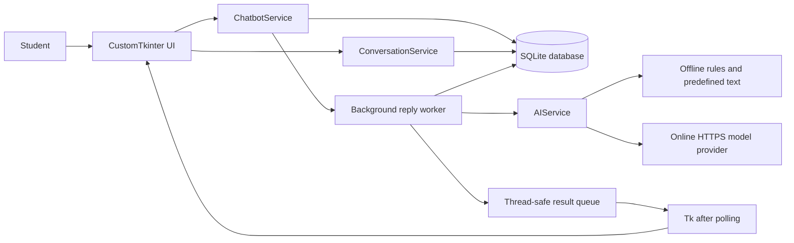
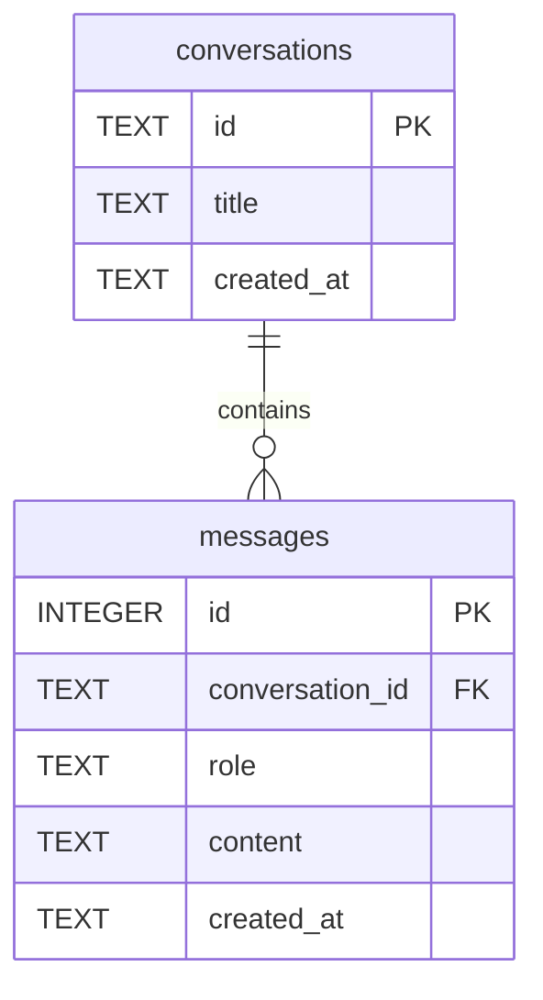

# StudyBuddy: a ten-minute, five-person presentation

Rehearse with a timer. Each member has exactly two minutes. Keep `.env` closed
and demonstrate with ordinary example questions. Have Offline Demo ready even
if you also plan to show an online provider.

## Member 1 — Introduction (0:00–2:00)

**0:00–0:40:** “StudyBuddy is a desktop assistant for students. We built a chat
interface where you can ask study questions, revisit conversations, and keep
history after closing the application.” Show the app name and sidebar.

**0:40–1:20:** “We used Python for the program, CustomTkinter for the window,
SQLite for local storage, and an optional external AI API. The app works in two
explicit modes. Offline Demo selects predefined educational responses. Online AI
sends a request to a model provider.” Point out the mode badge.

**1:20–2:00:** “Our goal was a reliable program we can explain. We separated the
interface, backend, AI client, and database so each part has one job.” Show this
diagram and hand over to Member 2.



## Member 2 — Frontend and UI (2:00–4:00)

**2:00–2:45:** “The sidebar lists conversations. New Chat starts a conversation;
Delete Chat asks for confirmation. The main panel has distinct message bubbles,
timestamps, a mode badge, and a multiline input.” Point to each component.

**2:45–3:20:** Demonstrate resizing, Enter to send, and Shift+Enter for a newline.
“A scrollable frame handles long history. We use a dark theme and rounded
components. Blank messages and messages above 4,000 characters are rejected.”

**3:20–4:00:** “While a response is pending, a loading bar runs and affected
controls are disabled. The window stays responsive because the network call runs
in a worker thread. Errors are visible and the user can retry.” Point to
`ui/main_window.py`, `chat_panel.py`, and `sidebar.py` without reading entire files.

## Member 3 — Backend and AI processing (4:00–6:00)

**4:00–4:45:** “ChatbotService validates the question and saves it once. A worker
loads the original conversation, calls AIService, and saves the answer against
the original message ID. This prevents replies going into a different chat.”

**4:45–5:25:** “Offline mode is rule-based, not generative AI. Online mode sends
JSON containing a system instruction and conversation history to an external
model over verified HTTPS. The endpoint is the configured API root plus
`/chat/completions`. Stored demo answers are excluded from online context.”

**5:25–6:00:** “The API key is configured privately. We handle missing settings,
invalid access, quotas, timeouts, network failures, and malformed responses.
Failures preserve the question. Retry requests a reply without adding the
question twice. A thread-safe queue returns results to Tk's main thread.”

## Member 4 — Database and SQL (6:00–8:00)

**6:00–6:40:** “SQLite stores data in a local file. Conversations have UUIDs and
titles. Messages have integer IDs, roles, text, and timestamps. A conversation
can have many messages.” Show the relationship diagram.



**6:40–7:20:** “The foreign key connects a message to its conversation. We enable
foreign keys on every connection. Deleting a conversation cascades to its
messages. Queries order by message ID, so messages remain in the correct order.”

**7:20–8:00:** Show this small example from `get_messages()`:

```python
connection.execute(
    "SELECT * FROM messages WHERE conversation_id = ? ORDER BY id ASC",
    (conversation_id,),
)
```

“The placeholder keeps values separate from SQL. Transactions commit complete
changes or roll them back. Connections close reliably and are never shared across
threads. The file path is based on the project location.”

## Member 5 — Live demonstration and conclusion (8:00–10:00)

Prepare one saved conversation before starting. Keep the demo to these actions:

1. **8:00–8:25:** Start the app and show the Offline Demo badge. Open the saved
   conversation to demonstrate persistence.
2. **8:25–8:55:** Start New Chat and ask “Explain Python classes.” Read the first
   sentence and point out `[OFFLINE DEMO — predefined response]`.
3. **8:55–9:20:** Ask “How does SQLite store messages?” Show the second response,
   then switch between the two conversations.
4. **9:20–9:40:** Delete the demo conversation with confirmation. Explain that its
   messages are removed, while the other conversation remains.
5. **9:40–10:00:** “We tested persistence, validation, safe API error handling,
   retries, and the desktop interactions. Live online answers require our own
   provider configuration. We learned to connect a GUI, backend, database, and
   API without blocking the interface.”

If demonstrating Online AI too, replace the second question with a short live
request in a separate online session prepared in advance; account for network
latency within the same time limit. Never claim mocked tests prove a live model
connection. Model answers can be wrong, so verify academic content.

## Offline backup plan

Before class, verify `AI_MODE=offline` (or remove the online override), restart,
and confirm the badge. Run once without internet. Prepare the exact Python and
SQLite questions above. This demonstration needs no credentials and is honest
about its fixed responses. If internet fails during an online demo, announce the
failure, switch `.env` to offline privately, restart, and use a new chat. Do not
pretend the fixed answers came from the provider.

## Five likely instructor questions

1. **Is your offline mode really AI?** No. It matches keywords to predefined
   responses for a dependable classroom demonstration. Online mode connects to
   an external model. The badge and response label distinguish them.
2. **Why SQLite instead of a server database?** It is built into Python, stores
   structured data in one local file, and suits this single-user desktop project.
   It needs no separate database service.
3. **How do you keep the GUI responsive?** Network calls run in a worker. The
   worker sends results through a queue; Tk's `after()` polls that queue on the
   main thread. Only the main thread touches widgets.
4. **How do you protect the key and SQL queries?** The key stays in private local
   configuration excluded from Git, TLS verification stays enabled, and errors
   avoid raw provider bodies. SQL uses parameters, foreign keys, and transactions.
5. **What happens when a request fails or the app closes?** The question is already
   saved. Retry reuses its ID. Closing marks the worker canceled; a completed
   answer may already be saved, otherwise the question can be retried after restart.

## Final rehearsal checklist

- Each person can explain their assigned class without reading code verbatim.
- The full run takes ten minutes, including handovers and application startup.
- Windows GUI checks pass on the actual presentation laptop.
- Offline examples work with no internet; an API key is never projected.
- Tests and their limits are described accurately: 25 backend tests and three
  real-window scenarios passed on Linux; live AI and Windows checks remain local.
